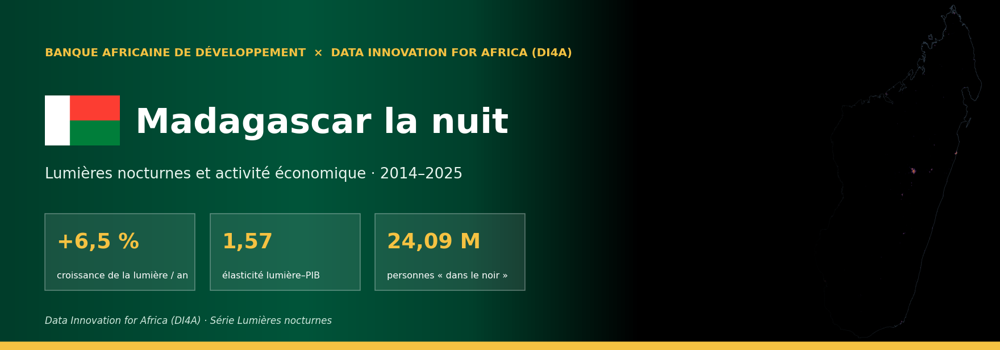
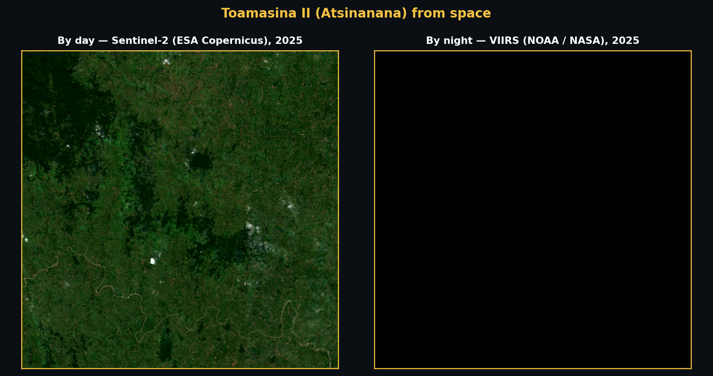
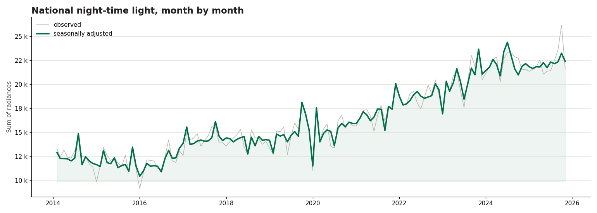
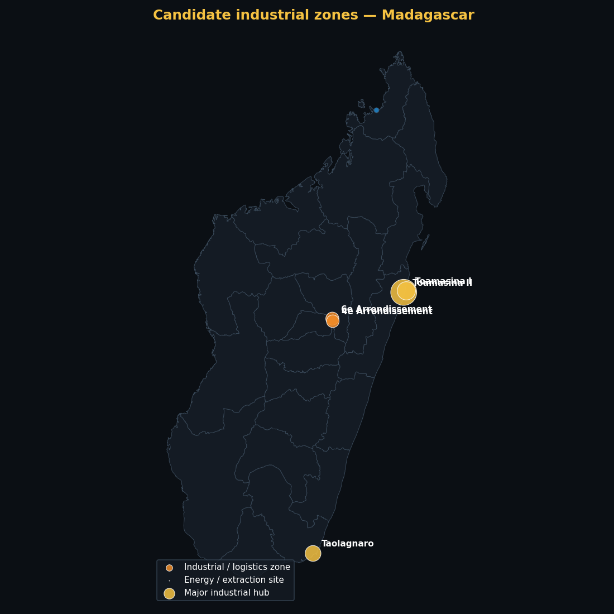
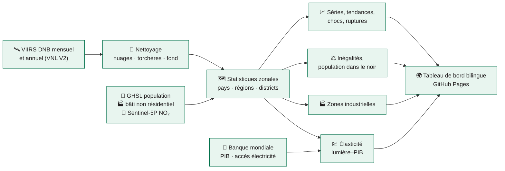

<!-- ntl-dashboard:auto — generated by the night-time lights notebook (part 3); edits will be overwritten -->

<b><a href="https://suphermani.github.io/ntl-dashboard/fr/">🌍 Tableau de bord</a> &nbsp;·&nbsp; <a href="https://suphermani.github.io/ntl-dashboard/fr/#map">🗺️ Carte</a> &nbsp;·&nbsp; <a href="https://suphermani.github.io/ntl-dashboard/fr/#time">📈 Évolution</a> &nbsp;·&nbsp; <a href="https://suphermani.github.io/ntl-dashboard/fr/#industry">🏭 Zones industrielles</a> &nbsp;·&nbsp; <a href="https://suphermani.github.io/ntl-dashboard/fr/#method">📐 Méthode</a> &nbsp;·&nbsp; <a href="https://suphermani.github.io/ntl-dashboard/fr/#data">⬇️ Données</a> &nbsp;·&nbsp; <a href="README.md">🌐 English</a></b>

     

> [!NOTE]
> Ce dépôt héberge le **tableau de bord public** de l'activité économique de **Madagascar** mesurée par les lumières nocturnes vues par satellite (2014–2025). Le site est bilingue (français / anglais), entièrement statique et régénéré à chaque exécution du notebook.

## 📊 Chiffres clés

<table>
<tr>
<td align="center" width="33%">📈 Croissance annuelle de la lumière <h3>+6,5 %</h3>2014–2025, pente robuste (Theil–Sen)</td>
<td align="center" width="33%">🗓️ 12 derniers mois vs 12 précédents <h3>+0,2 %</h3>série désaisonnalisée, jusqu'à 11/2025</td>
<td align="center" width="33%">💹 Élasticité lumière–PIB <h3>1,57</h3>IC 95 % 0,96 à 2,18 · confiance moyenne</td>
</tr>
<tr>
<td align="center" width="33%">⚖️ Gini de la lumière par habitant <h3>0,65</h3>unités ADM2, 2025</td>
<td align="center" width="33%">🌑 Personnes dans le noir <h3>24,09 M</h3>78 % de la population habitée, 2025</td>
<td align="center" width="33%">🏙️ Part de la 1ʳᵉ région <h3>35 %</h3>Analamanga, 2025</td>
</tr>
</table>

## 💡 Messages clés

1. **Tendance nationale** — Entre 2014 et 2025, la lumière nocturne de Madagascar a évolué de +6,5 % par an (IC 95 % : +5,2 % à +7,9 %). Sur les 12 derniers mois, le niveau désaisonnalisé est +0,2 % par rapport aux 12 mois précédents.  
   🟢 élevée · tendance significative (p < 0,01 ; n = 12)
2. **Régions** — Sur 119 unités ADM2, 85 sont en croissance significative, 18 stagnent et 1 déclinent. L'activité lumineuse reste concentrée : Analamanga concentre 35 % de la lumière nationale.  
   🟠 moyenne · classement sur 119 unités, seuil ±1 %/an et p < 0,10
3. **Convergence** — Entre unités ADM2, la lumière par habitant converge : les unités les moins éclairées rattrapent leur retard.  
   🟠 moyenne · β = −0,024 [−0,033 ; −0,014], n = 99
4. **Lien avec le PIB** — L'élasticité de la lumière au PIB réel est de 1,57 en niveaux (IC 95 % : 0,96 à 2,18, R² = 0,93, 12 années) et de 0,54 en taux de croissance (IC : 0,15 à 0,93). En pseudo temps réel (chaque année prédite à partir des seules années antérieures), la croissance de la lumière suit celle du PIB avec une corrélation de −0,42 (erreur absolue moyenne : 2,8 point(s) de croissance, mieux que la meilleure prévision naïve, rapport d'erreur 0,88).  
   🟠 moyenne · n = 12, significatif mais IC large (1,22)
5. **Chocs** — Le choc le plus marqué dans la série désaisonnalisée est « COVID-19 » : creux de -9,6 % (07/2020), retour au niveau d'avant-choc après 5 mois.  
   🔴 faible · creux comparé à la variabilité mensuelle d'avant-choc
6. **Inégalités et accès** — Le Gini de la lumière par habitant (ADM2) vaut 0,65 en 2025 (baisse significative depuis 2014). Environ 24,09 million(s) de personnes vivent dans des zones habitées sans lumière détectable (78 % de la population habitée).  
   🟠 moyenne · sensible au seuil de radiance (de 1,28 à 25,10 M selon le seuil) ; proxy d'éclairage extérieur, pas de raccordement
7. **Zones industrielles** — 5 zones industrielles candidates sont détectées (3 pôles majeurs, 0 sites énergétiques), sur 5 km². Elles émettent 4 % de la lumière nationale ; la première est Toamasina II (Atsinanana). Leur lumière évolue de -0,0 % par an.  
   🟠 moyenne · 100 % des zones confirmées par OpenStreetMap ; candidats à vérifier

## 🛰️ Le jour et la nuit

Le principal pôle économique du pays (Toamasina II (Atsinanana)), le jour vu par Sentinel-2 et la nuit vu par VIIRS. Ce que le satellite voit la nuit — l'éclairage des villes, des ports, des usines et des routes — est l'indicateur indirect d'activité utilisé dans tout ce projet.

## 📈 La tendance

La courbe désaisonnalisée retire les effets de saison (neige, végétation, fêtes) : c'est elle qu'il faut lire pour juger d'une hausse ou d'une baisse.

## 🏭 Zones industrielles

Les sites industriels brillent la nuit comme les villes, mais leurs bâtiments sont surtout non résidentiels, peu de gens y habitent et ils émettent du NO₂. En combinant VIIRS, GHSL (bâti non résidentiel, population) et Sentinel-5P, **5 zones candidates** sont détectées ; elles émettent **4 %** de la lumière nationale. 100 % d'entre elles contiennent une zone industrielle répertoriée dans OpenStreetMap (± 1 km).

| # | Zone | Type | Surface | Part de la lumière nationale | Croissance / an |
|---:|---|---|---:|---:|---:|
| 1 | Toamasina II (Atsinanana) | Pôle industriel majeur | 3,5 km² | 2,7 % | -1,7 % |
| 2 | Toamasina I (Atsinanana) | Pôle industriel majeur | 0,4 km² | 0,6 % | +8,1 % |
| 3 | Taolagnaro (Anosy) | Pôle industriel majeur | 0,6 km² | 0,3 % | -1,5 % |
| 4 | 6e Arrondissement (Analamanga) | Zone industrielle / logistique | 0,6 km² | 0,1 % | +2,3 % |
| 5 | 4e Arrondissement (Analamanga) | Zone industrielle / logistique | 0,4 km² | 0,1 % | -0,7 % |

## 🧭 Ce que contient le tableau de bord

| Page | Ce que l'on y trouve |
|---|---|
| [**Vue d'ensemble**](https://suphermani.github.io/ntl-dashboard/fr/#overview) | chiffres clés, messages générés automatiquement avec leur niveau de confiance |
| [**Carte**](https://suphermani.github.io/ntl-dashboard/fr/#map) | lumière année par année, variation, statistiques régionales au survol |
| [**Évolution**](https://suphermani.github.io/ntl-dashboard/fr/#time) | série mensuelle observée et désaisonnalisée, glissement annuel, série longue 1992 → |
| [**Régions**](https://suphermani.github.io/ntl-dashboard/fr/#regions) | croissance par région et district, classes, concentration et convergence |
| [**Chocs**](https://suphermani.github.io/ntl-dashboard/fr/#shocks) | COVID-19 et autres événements : creux, reprise, test placebo, indice quotidien |
| [**Inégalités**](https://suphermani.github.io/ntl-dashboard/fr/#inequality) | Gini, courbes de Lorenz, Theil, population « dans le noir » |
| [**Zones industrielles**](https://suphermani.github.io/ntl-dashboard/fr/#industry) | zones candidates, score, tendance, validation OpenStreetMap |
| [**Méthode & limites**](https://suphermani.github.io/ntl-dashboard/fr/#method) | sources, paramètres, hypothèses et biais connus |
| [**Données**](https://suphermani.github.io/ntl-dashboard/fr/#data) | toutes les tables téléchargeables, manifeste de reproductibilité |

## ⚙️ Comment c'est calculé

Chaîne de traitement exécutée dans Google Earth Engine depuis le notebook *Lumières nocturnes et activité économique* (partie 3) :

<b>Les six analyses en détail</b>

| | |
|---|---|
| **📈 Dynamique temporelle** | décomposition STL, glissement annuel, tendance de Theil–Sen et test de Mann–Kendall, anomalies, ruptures |
| **🗺️ Croissance régionale** | classes Croissance / Stagnation / Déclin (correction de Benjamini–Hochberg), HHI, convergence β et σ |
| **💹 Lumières et PIB** | élasticité (erreurs HAC, bootstrap), prévision immédiate jugée face à deux prévisions naïves, PIB régional expérimental |
| **⚡ Chocs** | creux, écart à la tendance, mois de reprise, test placebo, indice quotidien Black Marble |
| **⚖️ Inégalités et accès** | Gini, Theil (entre / intra-régions), ratio urbain / rural, population dans le noir sur trois seuils |
| **🏭 Zones industrielles** | score à quatre signaux (lumière, bâti non résidentiel, faible densité, NO₂), validation OpenStreetMap |

## ⚠️ Limites à connaître

> [!IMPORTANT]
> Les lumières mesurent un rayonnement vers 1 h 30, pas une valeur ajoutée. À garder en tête :
>
> - **Débordement et saturation** — la lumière déborde du bâti ; les centres les plus brillants plafonnent
> - **Torchères** — brillantes sans activité locale : masquées, mais à surveiller
> - **Saisonnalité** — nuages, feux et végétation créent des cycles non économiques
> - **Ruptures de capteur** — DMSP → VIIRS, VNL V2.1 → V2.2 : corrigées par indicatrices, pas éliminées
> - **Zones rurales** — le signal est le plus faible là où vivent les ruraux pauvres
> - **Statut** — estimations expérimentales, pas des statistiques officielles

## ⬇️ Télécharger les données

| Fichier | Contenu |
|---|---|
| [`monthly_national.csv`](https://suphermani.github.io/ntl-dashboard/fr/data/MDG/monthly_national.csv) | série nationale mensuelle : observée, désaisonnalisée, tendance, anomalies |
| [`annual_units.csv`](https://suphermani.github.io/ntl-dashboard/fr/data/MDG/annual_units.csv) | une ligne par unité et par année : lumière, population, lumière/hab., population dans le noir |
| [`regions.csv`](https://suphermani.github.io/ntl-dashboard/fr/data/MDG/regions.csv) | indicateurs de la dernière année par région et district (carte, classement) |
| [`gdp.json`](https://suphermani.github.io/ntl-dashboard/fr/data/MDG/gdp.json) | élasticité lumière–PIB, prévision immédiate, PIB régional expérimental |
| [`shocks.json`](https://suphermani.github.io/ntl-dashboard/fr/data/MDG/shocks.json) | événements, creux, reprise, ruptures, anomalies, indices quotidiens |
| [`inequality.json`](https://suphermani.github.io/ntl-dashboard/fr/data/MDG/inequality.json) | Gini, Lorenz, Theil, population dans le noir et sensibilité aux seuils |
| [`industrial.geojson`](https://suphermani.github.io/ntl-dashboard/fr/data/MDG/industrial.geojson) | zones industrielles candidates (géométries et indicateurs) |
| [`meta.json`](https://suphermani.github.io/ntl-dashboard/fr/data/MDG/meta.json) | paramètres, versions des logiciels, disponibilité des données : la reproductibilité |

📁 [`gh-pages/data/MDG/`](https://github.com/SupHerMani/ntl-dashboard/tree/gh-pages/data/MDG)

## 📚 Données et licences

| Donnée | Producteur | Licence |
|---|---|---|
| VIIRS DNB VNL V2 et mensuel VCMSLCFG | NOAA / Earth Observation Group | domaine public, citation demandée |
| NASA Black Marble VNP46A2 | NASA | domaine public |
| GHSL GHS-POP, GHS-BUILT-S, GHS-SMOD R2023A | Commission européenne, JRC | CC BY 4.0 |
| Sentinel-2 L2A, Sentinel-5P TROPOMI NO₂ | ESA / Copernicus | licence Copernicus (libre) |
| Limites administratives geoBoundaries | William & Mary geoLab | CC BY 4.0 |
| Indicateurs du développement (WDI) | Banque mondiale | CC BY 4.0 |
| Zones industrielles (validation) | OpenStreetMap | ODbL |

## 🗂️ Organisation du dépôt

- `main` — cette page : présentation, illustrations (`docs/img/`), licence, citation
- `gh-pages` — le site publié : `index.html`, `assets/`, `data/<ISO3>/` (toutes les tables téléchargeables), version anglaise dans `en/`

## 🔁 Reproduire ou adapter à un autre pays

Le site est produit par le notebook **Lumières nocturnes et activité économique** (partie 3) (Colab). Changer le code `ISO3` dans la cellule de paramètres suffit pour analyser un autre pays ; les sections 12 et 13 exportent puis republient ce dépôt.

## 🤝 Crédits et citation

Réalisé par la **Banque africaine de développement** dans le cadre de **Data Innovation for Africa (DI4A)**. Les estimations sont expérimentales et ne constituent pas des statistiques officielles.

**Licence** — contenus CC BY 4.0, code MIT (voir `LICENSE`). Toute réutilisation doit mentionner : **Source : Banque africaine de développement – Data Innovation for Africa (AfDB-DI4A)**.

**Citation suggérée**

> Banque africaine de développement — Data Innovation for Africa (DI4A) (2026). *Lumières nocturnes et activité économique · 2014–2025 — Madagascar*. https://suphermani.github.io/ntl-dashboard/fr/

---

© 2026 AfDB-DI4A · Toute réutilisation doit mentionner « Source : AfDB-DI4A »

Dernière mise à jour : 2026-10-27 · <a href="#top">↑</a>

